# Apuração 2026

### 👉 [elei-es-production.up.railway.app](https://elei-es-production.up.railway.app)

**A apuração das eleições de 2026 em tempo real, com os números do TSE, no celular, no computador e na TV.**

Domingo, 25 de outubro de 2026, a partir das 17h (horário de Brasília): 2º turno para presidente e para governador no Acre, Amazonas, Distrito Federal, Espírito Santo, Rio Grande do Norte e Tocantins.

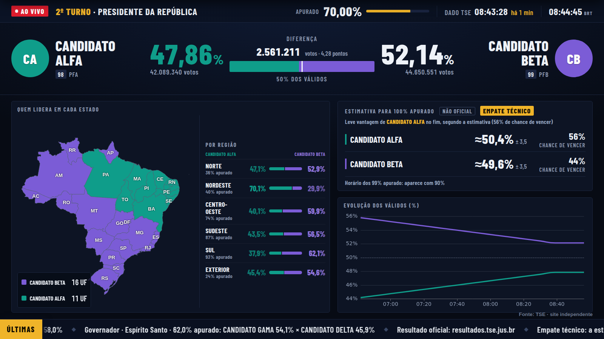

<sub>As imagens usam candidatos e partidos fictícios (Alfa, número 98, e Beta, número 99) e números de teste.</sub>

### O que o site mostra

- **Placar ao vivo** com os números oficiais do TSE, atualizados a cada 20 segundos.
- **Aviso de eleito** só quando não há mais como o resultado mudar, com a foto do eleito em tela cheia, até para quem estava com o celular bloqueado.
- **Estimativa do resultado final** (não oficial): calculada estado por estado a partir do 1º turno, com margem de erro, chance de vencer, aviso de empate técnico, de possível virada e de "vitória projetada" quando a tendência já define o vencedor.
- **Resultado por região** (Norte, Nordeste, Centro-Oeste, Sudeste, Sul e exterior), **mapa** de quem lidera em cada estado e em cada município, e o gráfico da evolução da contagem.
- **Funciona com a internet ruim**: se a conexão cair, o site avisa e mostra os últimos números; volta sozinho quando a internet voltar.
- **Modo TV**: tela cheia no formato de telejornal, com letreiro de últimas notícias da apuração (viradas, governadores, comparecimento).
- **Conferir minha seção**: o boletim da urna onde você votou.

Não é o TSE nem de nenhum partido. O resultado oficial é sempre o de [resultados.tse.jus.br](https://resultados.tse.jus.br). Como o site faz as contas está explicado, com as fórmulas, em [/sobre#metodologia](https://elei-es-production.up.railway.app/sobre#metodologia).

### Galeria

**Modo TV** (tela cheia, para deixar ligado na TV ou no computador)

| Antes da apuração | Vitória projetada |
|---|---|
| 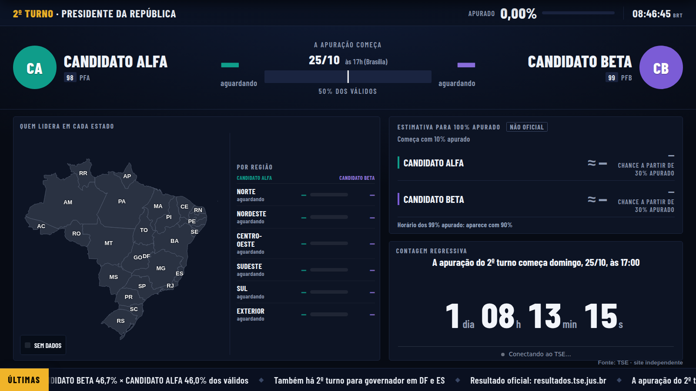 | 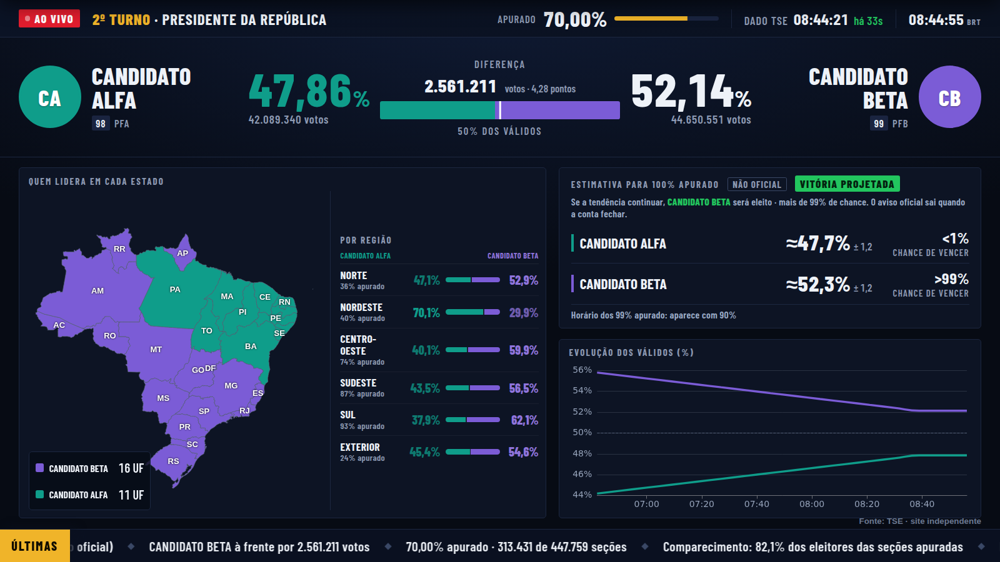 |
| Contagem regressiva, mapa, regiões e letreiro esperando as 17h. | Com mais de 99% de chance pela tendência, a estimativa avisa (não oficial). |

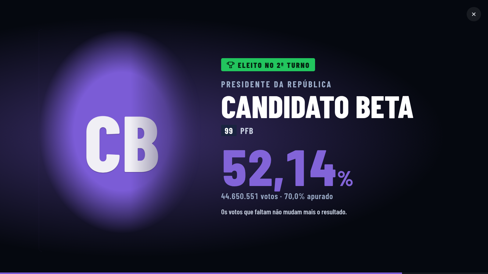

<sub>Quando os votos que faltam não mudam mais o resultado, o eleito ocupa a tela.</sub>

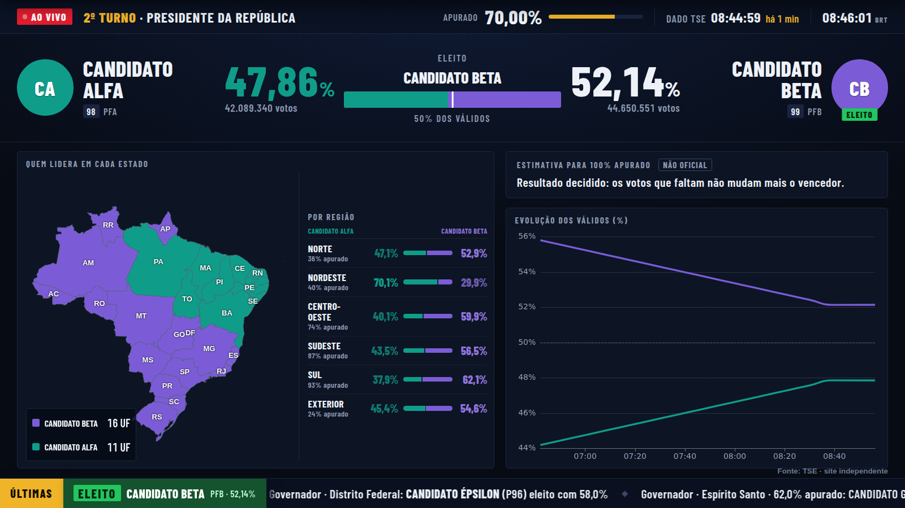

<sub>Depois do troféu, o placar e o letreiro continuam mostrando o eleito.</sub>

**Computador**

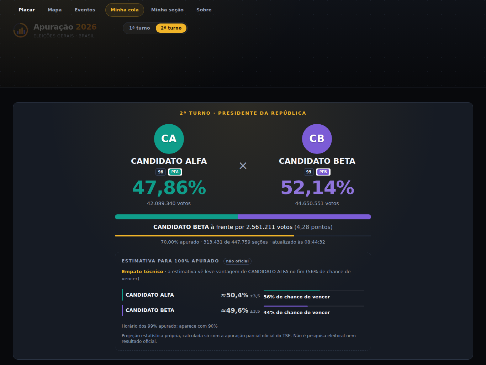

| Por região | Mapa por estado |
|---|---|
| 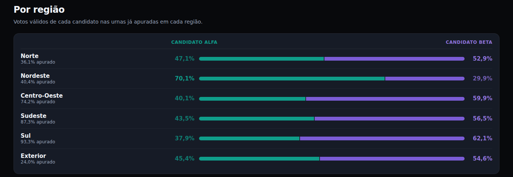 | 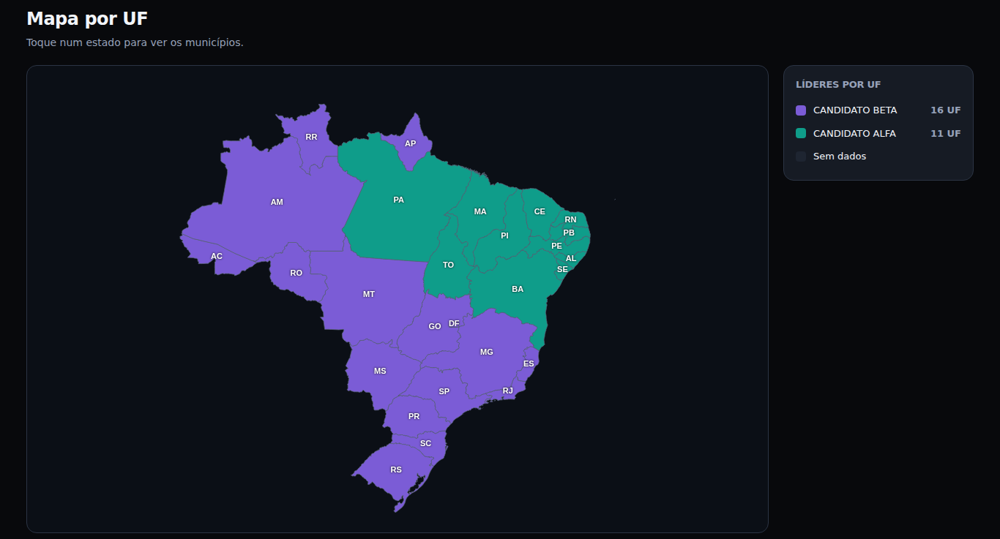 |

| Evolução da apuração | Vencedor |
|---|---|
| 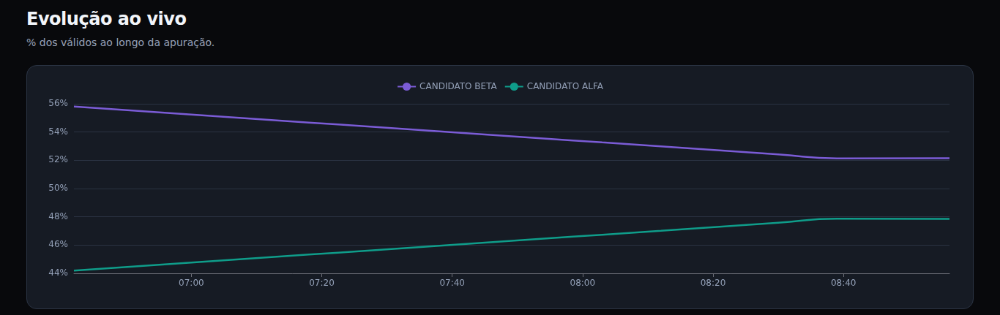 | 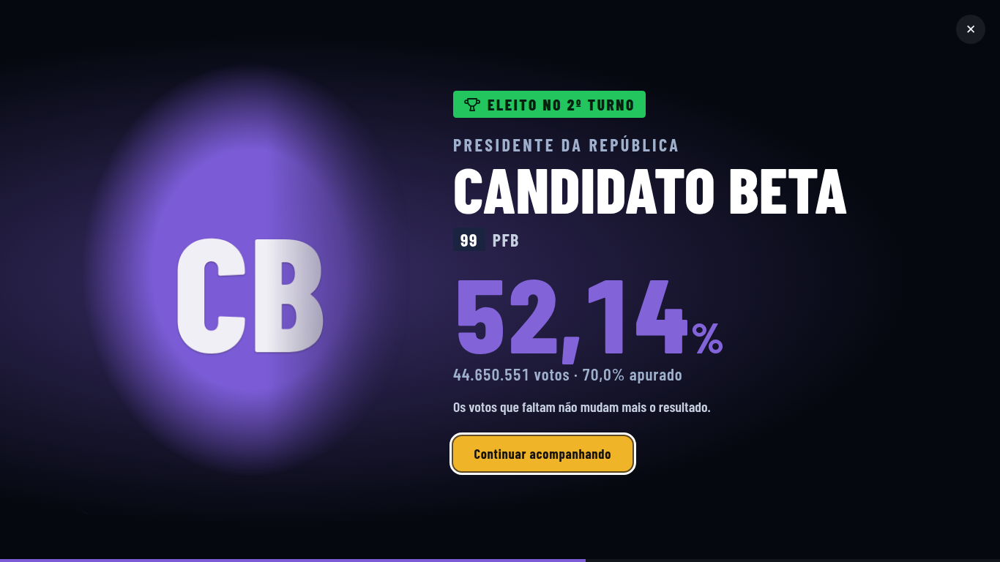 |

**Celular**

| Antes da apuração | Durante | Vitória |
|---|---|---|
| 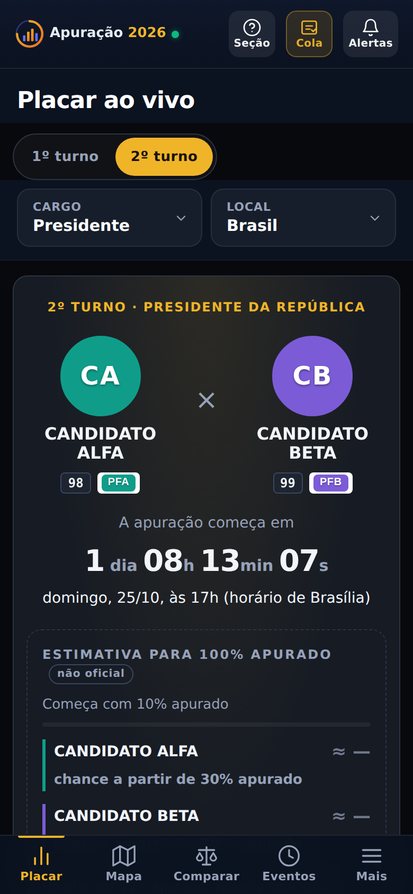 | 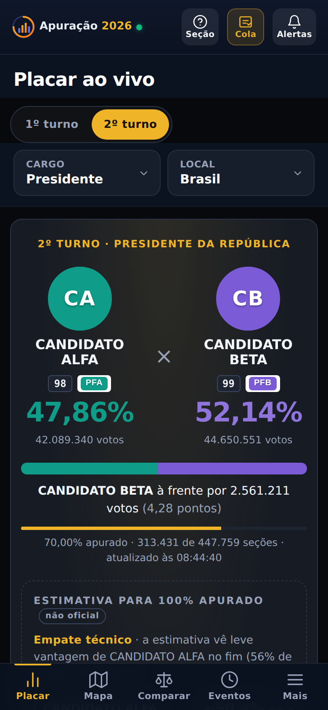 |  |

### Avisos no Telegram

O bot **[@avisoeleicao_bot](https://t.me/avisoeleicao_bot)** avisa quando alguém for eleito, quando houver virada e em boletins durante a apuração (25%, 50%, 75%, 90%). Também responde ao placar e à estimativa a qualquer momento: `/placar`, `/estimativa`, `/mapa`.

### Para compartilhar

> 🗳️ Apuração do 2º turno ao vivo, direto dos números do TSE: placar, mapa por estado, estimativa do resultado final e modo TV. Domingo, 25/10, a partir das 17h.
> https://elei-es-production.up.railway.app
>
> Avisos no Telegram: https://t.me/avisoeleicao_bot

Dica: na TV ou no computador, abra o site e toque em **📺 Modo TV** no rodapé.

---

## Para desenvolvedores

Painel web independente pra acompanhar a apuração das Eleições Gerais 2026 do TSE em tempo real, com motor matemático que calcula quando um resultado está definido (1º turno, 2º turno, majoritário, senador multi-vaga, proporcional) e alertas via bot do Telegram.

Não é o TSE. É um site de terceiro que consome os JSONs públicos que o próprio TSE publica em `resultados.tse.jus.br` e `divulgacandcontas.tse.jus.br`, e apresenta esses dados com regras matemáticas explícitas e verificáveis.

## Sumário

- [Stack](#stack)
- [Módulos](#módulos)
- [Motor matemático](#motor-matemático)
- [Rodando em dev](#rodando-em-dev)
- [Deploy no Railway](#deploy-no-railway)
- [Bot do Telegram](#bot-do-telegram)
- [Coleta via Termux (bypass Akamai)](#coleta-via-termux-bypass-akamai)
- [Estrutura do repositório](#estrutura-do-repositório)
- [Documentação](#documentação)

## Stack

- **Backend**: FastAPI + SQLAlchemy 2 async + asyncpg
- **Banco**: PostgreSQL 16 (JSONB pra snapshots brutos e ficha de candidato)
- **Frontend**: Vanilla JS + ECharts, mobile-first com bottom nav, sem framework
- **Realtime**: WebSocket + Web Push (opcional) + Bot do Telegram (opcional)
- **Deploy**: Railway (Dockerfile + Procfile + nixpacks.toml)
- **Motor matemático**: módulo puro sem I/O, cobertura 44 testes pytest

## Módulos

O sistema tem cinco módulos independentes que se comunicam pelo banco:

1. **`poller/`** — coleta a cada 20s os JSONs oficiais do TSE, deduplica por SHA-256, persiste um snapshot por (cargo, abrangência), marca snapshots suspeitos (regressão de seções totalizadas), avalia o motor matemático e emite eventos.
2. **`math_engine/`** — módulo puro. Decide "eleito no 1º turno", "2º turno definido", "eleito majoritário (1 ou 2 vagas)", "matematicamente eliminado", "virada iminente", e o cálculo proporcional completo (QE + Fase 1 QP + Fase 2 sobras 80/20 + Fase 3 residual STF). Todas as regras usam desigualdade estrita.
3. **`app/`** — API FastAPI (REST + WebSocket + páginas HTML servidas do `static/`). Admin token nos endpoints administrativos, CORS configurável.
4. **`notif/telegram_bot.py`** — bot do Telegram com 13 comandos de consulta ao vivo (`/placar`, `/lider`, `/vs`, `/mapa`, `/candidato`, `/eventos`, `/status`, ...) + assinatura de alertas (`/assinar`, `/minhas`, `/pausar`, `/silencio`).
5. **`static/`** — frontend zero-framework. Design responsivo com dois chromes (desktop com top-nav + hero grande + big-number Apurado; mobile com bottom-nav de 5 abas, chips clicáveis, bottom sheet, FAB de comparar). Icon set SVG unificado, logo próprio, motion tokens que respeitam `prefers-reduced-motion`.

## Motor matemático

Todas as regras usam desigualdade **estrita** — se ainda for possível empate exato, o resultado fica em disputa. O motor só corre depois de ≥20% das seções totalizadas.

Formulários (`math_engine/engine.py`):

- `votos_restantes_max = eleitorado_apto − eleitorado_apto_totalizadas` (clampado em 0).
- **Presidente eleito 1T**: `votos_lider × 2 > votos_validos + restantes_max` (art. 77 §2º CF, maioria absoluta dos válidos).
- **2º turno definido** (duas condições estritas):
  1. Líder não pode mais fechar 1T: `(a.votos + restantes) × 2 ≤ validos_max`.
  2. 3º não alcança 2º: `c.votos + restantes < b.votos`.
- **Majoritário (1 vaga — Governador)**: `b.votos + restantes < a.votos`.
- **Majoritário multi-vaga (Senador 2026, 2 vagas por UF)**: `N-ésimo.votos > (N+1)-ésimo.votos + restantes`. Emite ELEITO_MAJORITARIO para os top-N.
- **Matematicamente eliminado**: `max_final_cand < pos_alvo.votos`. Pra Presidente/Senador-2026, `pos_alvo` é o 2º; pra Governador, o 1º.

**Proporcional** (`math_engine/proporcional.py`) — Deputado Federal/Estadual, três fases:

1. **Fase 1 (QP direto)**: partido/federação com QP ≥ 1 leva vagas, candidato precisa ≥10% do QE.
2. **Fase 2 (sobras 80/20, Lei 14.211/2021)**: unidade ≥80% do QE + candidato ≥20% do QE, distribuição por D'Hondt.
3. **Fase 3 (residual, STF ADI 7228/7263 de 2024)**: todos os partidos, sem barreira do candidato, distribuição por D'Hondt.

Federações partidárias (Lei 14.208/2021) somam votos e agem como uma única unidade. Default: PT+PCdoB+PV, PSOL+REDE, PSDB+Cidadania.

Detalhes completos e fontes primárias em `docs/metodologia.md`.

## Rodando em dev

```bash
cp .env.example .env
docker compose up --build          # postgres + app + nginx em http://localhost:8080
docker compose run --rm app alembic upgrade head
docker compose run --rm app python -m scripts.seed
```

Sem Docker:

```bash
pip install -e .[dev]
alembic upgrade head
python -m scripts.seed
uvicorn app.main:app --reload
```

Testes (44 verdes):

```bash
python -m pytest tests/ -v
```

Detalhes em `docs/getting-started.md`.

## Deploy no Railway

1. `New Project → Deploy from GitHub repo` neste repositório.
2. `+ New → Database → Add PostgreSQL`. Railway injeta `DATABASE_URL` sozinho; o app normaliza `postgres://` para `postgresql+asyncpg://`.
3. Variáveis (Settings → Variables):
   - `ADMIN_TOKEN` — obrigatório. Protege endpoints `/api/admin/*`.
   - `CORS_ORIGINS` — URL pública do serviço.
   - `TELEGRAM_BOT_TOKEN`, `TELEGRAM_BOT_USERNAME` — habilita o bot.
   - `POLL_INTERVAL_SECONDS`, `VAPID_PUBLIC_KEY`/`VAPID_PRIVATE_KEY` — opcionais.
4. `Settings → Networking → Generate Domain`. Healthcheck em `/health` (checa `SELECT 1` no banco).

O deploy roda automaticamente `alembic upgrade head` e `scripts.seed` no start (ambos idempotentes). Detalhes de operação em `docs/operations.md`.

## Bot do Telegram

Consulta ao vivo:

```
/placar [cargo] [uf]   — top 8 candidatos com barras
/lider [cargo] [uf]    — quem lidera + margem
/pct [cargo] [uf]      — % apurado
/candidato <n> [uf]    — ficha completa (nome, partido, ocupação, nascimento)
/vs <n1> <n2> [uf]     — dois candidatos lado a lado
/mapa [cargo]          — líder por UF
/proporcional <uf>     — dep. federal (QE + D'Hondt)
/estadual <uf>         — dep. estadual
/eventos [cargo] [uf]  — últimos 15 eventos matemáticos
/status                — totais + hash SHA-256 do snapshot (verificável)
/cola <n> [uf]         — foto do candidato
/tse                   — link pra apuração oficial
```

Alertas:

```
/assinar               — wizard inline (cargo → UF → tipos de evento)
/minhas                — suas assinaturas
/pausar · /retomar     — pausa/retoma tudo
/silencio 00-07        — janela sem alertas (BRT)
/apagar_tudo           — remove todas
```

Assinatura casa `(cod_cargo, abrangencia)` da assinatura com o evento emitido pelo poller. Envio respeita pausa global e janela de silêncio.

## Coleta via Termux (bypass Akamai)

O TSE bloqueia o backend do Railway (fora do BR) via Akamai no `divulgacandcontas.tse.jus.br` — 403 sistemático. `resultados.tse.jus.br` (a apuração ao vivo) não tem Akamai e o Railway acessa direto.

Pra baixar a ficha completa dos candidatos majoritários (nascimento, sexo, ocupação, gastos, vice), roda-se `scripts/importar_termux.py` do celular do usuário (IP residencial BR + curl-cffi impersonando Chrome TLS). Ele bate no TSE, pega a ficha, e POSTa em `/api/admin/atualizar-detalhe` (requer `ADMIN_TOKEN`).

Uso:

```bash
pkg install python
pip install curl-cffi
export ADMIN_TOKEN="mesmo_valor_do_railway"
python scripts/importar_termux.py https://elei-es-production.up.railway.app
```

Detalhes em `docs/operations.md`.

## Estrutura do repositório

```
app/
  main.py             # FastAPI factory, lifespan, /health, rotas de página
  api.py              # todos os endpoints REST + admin (protegidos por token)
  ws.py               # WebSocket broadcaster
  config.py           # pydantic-settings; normalização DATABASE_URL do Railway
  db.py               # SessionLocal async
  models.py           # SQLAlchemy 2 declarative — 12 tabelas
poller/
  service.py          # loop principal com semáforo e alvos
  parser.py           # parser tolerante dos JSONs do TSE
  candidatos_tse.py   # sincroniza candidatos + fotos
  descoberta.py       # descobre cod_eleicao real conforme TSE publica
  tse_client.py       # httpx com headers de navegador
math_engine/
  engine.py           # eleito 1T, 2t, majoritário 1/N vagas, eliminado, virada
  proporcional.py     # Quociente Eleitoral + 3 fases das sobras + federações
notif/
  telegram_bot.py     # long polling + 13 comandos + wizard + alertas
static/
  index.html          # SPA
  app.js              # state, WS, motion helpers, mobile chrome
  app.css             # design tokens + card v2 + mobile app + motion
  sobre.html          # FAQ, termos, privacidade, metodologia, bases legais
  logo.svg            # marca própria (arco de progresso + gráfico)
  partidos/           # 30 logos oficiais dos partidos 2026
  mapa-br.js          # ECharts geo (aspectScale 1, corrigido)
alembic/versions/     # 4 migrations
scripts/
  seed.py             # cargos, UFs, partidos (idempotente)
  importar_termux.py  # coleta manual do celular
tests/                # 44 casos, todos verdes
docs/                 # documentação por tópico (ver abaixo)
```

## Documentação

- **[`docs/getting-started.md`](docs/getting-started.md)** — setup local (Docker e sem Docker), como rodar tests, primeiros comandos.
- **[`docs/metodologia.md`](docs/metodologia.md)** — motor matemático completo, com fontes primárias (Código Eleitoral, Lei 14.211/2021, STF ADI 7228/7263, Res. TSE 23.660/2022, EC 97/2017).
- **[`docs/operations.md`](docs/operations.md)** — Railway, admin token, Termux, Alembic, bot Telegram, healthcheck, monitoramento.
- **[`docs/api-reference.md`](docs/api-reference.md)** — endpoints REST + WebSocket.
- **[`docs/security.md`](docs/security.md)** — LGPD, admin token, rate limit, CORS, dados sensíveis.
- **[`docs/faq.md`](docs/faq.md)** — dúvidas técnicas de desenvolvedor (dev-facing). Para dúvidas de usuário final, veja `/sobre` no próprio site.
- **[`ARCHITECTURE.md`](ARCHITECTURE.md)** — camadas, contratos internos, decisões arquiteturais.
- **[`AGENTS.md`](AGENTS.md)** — mapa pra IAs/devs novos: "o que ler pra qual tarefa".
- **[`CHANGELOG.md`](CHANGELOG.md)** — histórico de mudanças.
- **[`CREDITS.md`](CREDITS.md)** — dependências e atribuições.

Página pública com FAQ, termos, privacidade e metodologia pro usuário final: [`static/sobre.html`](static/sobre.html) (servida em `/sobre`).

## Aviso

Este site não representa o TSE. As informações aqui exibidas são derivadas de dados públicos mas não têm fé pública. A fonte oficial e única com fé pública é o próprio TSE em [resultados.tse.jus.br](https://resultados.tse.jus.br). Divergências devem sempre ser resolvidas a favor do TSE.
